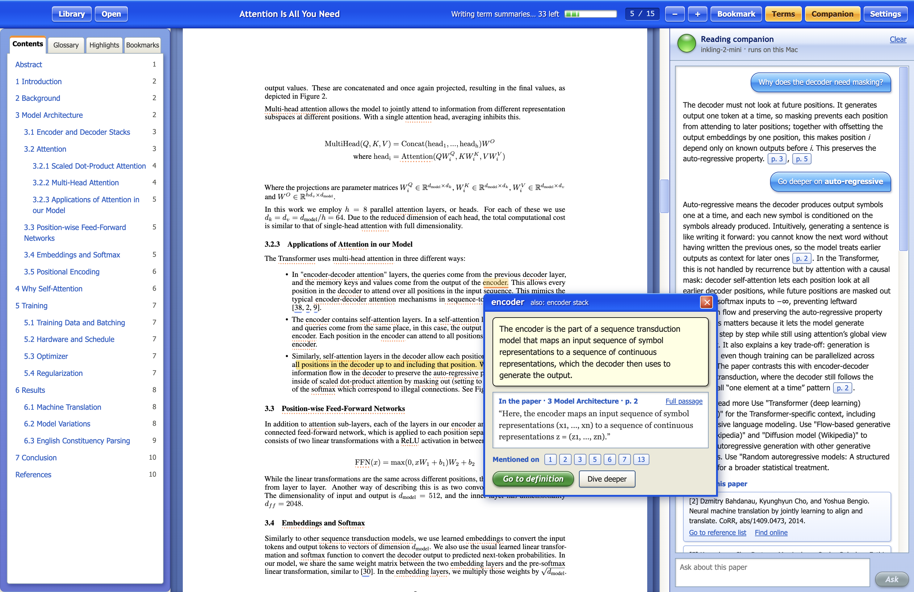

# QuickRead

A desktop PDF reader for research papers. Click a term to recall what it means without losing your place; ask a local model when you want to go deeper.



## Run it

```bash
npm start
```

`npm run dev` runs it with hot reload. To open a specific file: `npm start -- /path/to/paper.pdf`.

To build the standalone app:

```bash
npm run package
```

This writes `dist/mac-arm64/QuickRead.app`, which can be dragged into Applications. It is signed ad hoc for this Mac only. The app icon is `build/icon.icns`.

## Look

The interface is styled after early-2000s desktops: Luna-blue title bars, gel buttons, bevelled fields, an Explorer-style side pane and a messenger-style companion. It is all in `src/renderer/src/styles.css`, with the palette as CSS variables at the top.

## What it does

- **Term lookup.** Key terms are underlined as soon as a paper opens. Clicking one shows the sentence in the paper that defines it, the terms it builds on, the pages that mention it, and a button that jumps to the definition. A short summary from the local model streams in a few seconds later. A "Back" pill (or ⌘[) returns to where you were.
- **Any text.** Select a word or phrase and choose **Define** to look up something the glossary missed.
- **Citations.** Clicking a number such as `[38]` shows the bibliography entry and can find the paper online. arXiv papers can be opened directly in QuickRead.
- **Reading companion.** The side panel answers questions from the paper with page links. **Dive deeper** on a term gives a longer explanation plus further reading, drawn from the paper's own references and from Wikipedia, arXiv and OpenAlex.
- **Highlights, notes, bookmarks, contents.** Stored per paper and restored when it is reopened.

## How terms are found

No model reads the paper up front. `src/renderer/src/lib/terms.ts` does it with text statistics in about a tenth of a second:

1. **Important terms.** Candidate phrases are scored by C-value (frequent, long, and not merely part of a longer phrase), weighted by how rare their words are in everyday English, with boosts for appearing in headings, being defined with an acronym, and similar signals.
2. **Where each is defined.** Every sentence mentioning a term is scored for definition phrasing ("X is a", "we call X", a quoted first use), for position, and for sitting in a section named after the term.
3. **Term graph.** Term A depends on term B when B is part of A's name or appears in A's defining sentence. The card shows these as "Builds on".

The model is used for two small jobs only: one background call that removes false positives from the term list, and a summary when you open a term, written from that term's defining sentences and those of the terms it builds on.

`common-words.json` is the 30,000 most common English words, generated by `node scripts/build-wordlist.mjs`.

## Models

Everything runs locally through Ollama. QuickRead starts its own Ollama server on port 11435 (so it does not clash with another install on 11434) and stops it on quit.

| Role | Default | Change in |
| --- | --- | --- |
| Chat | `inkling-2-mini` | Settings |
| Embeddings | `embeddinggemma-2:270m` | Settings |

Only web searches leave the machine, and they carry just the search query.

## Layout

- `src/main` — window, storage, Ollama client, web search
- `src/renderer/src/lib/controller.ts` — PDF.js viewer wrapper: term and citation marks, highlights, jumps
- `src/renderer/src/lib/extract.ts` — text, sections and bibliography extraction
- `src/renderer/src/lib/brain.ts` — glossary, definitions, retrieval
- `src/renderer/src/App.tsx` — app state and the companion

Per-paper data lives in `~/Library/Application Support/quickread/docs/<id>/`.
